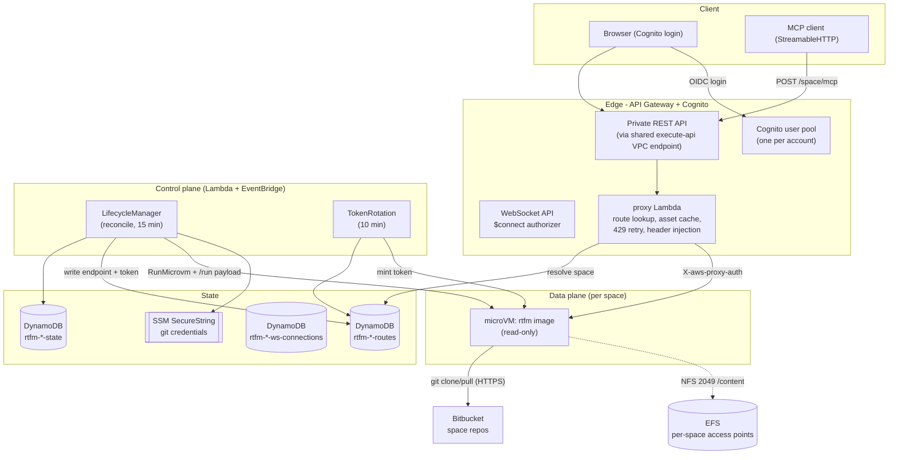

# RTFM - Architecture

Part of [RTFM](./index.md).

## Overview

RTFM is Lambda-only at the edge: **no CloudFront, no ALB, no Fargate**. A private API Gateway front door sends every request to a single **proxy Lambda**, which resolves the requested space to its live microVM. One read-only microVM runs per space; content is cloned from Bitbucket at runtime and persisted on EFS.

## Components

| Component | What it is | Where it lives |
|---|---|---|
| Space | One knowledge base: its own repo, microVM and route | env1 config + DynamoDB row + microVM |
| Front door | Private API Gateway REST API, custom domain via `switch-traffic` | app layer |
| proxy Lambda | Per-request routing from space to microVM | `service/control-plane/proxy` |
| LifecycleManager | Launches and reconciles space microVMs | `service/control-plane/lifecycle_manager` |
| TokenRotation | Refreshes proxy auth tokens before they expire | `service/control-plane/token_rotation` |
| ws-authorizer / ws-collab | WebSocket `$connect` authorizer and relay (collab is disabled) | `service/control-plane/` |
| `rtfm` microVM image | The image each space runs from | `lambda-microvms` image `rtfm` (out of Terraform) |
| run-hook server | Default VM process; receives per-space config at `/run` | `service/docker/microvm/` |
| `entrypoint.sh` | Mounts EFS, clones the repo, starts the app | `service/docker/` |

## Trust boundaries

- Browser to API Gateway: TLS plus a Cognito JWT on `/<space>/api/*`.
- API Gateway to microVM: only the proxy Lambda talks to microVMs, adding `X-aws-proxy-auth`. Client-supplied `Origin`, `Host` and `x-ok-forwarded-*` headers are stripped first.
- microVM to Bitbucket: HTTPS with a token minted by LifecycleManager. The long-lived secret never enters the VM.
- microVM to EFS: NFS (2049) through a VPC egress network connector.

## Key design decisions

- **One microVM per space** — Firecracker isolation, independent repos and routes.
- **Lambda-only edge** — the proxy Lambda resolves `space -> live VM` per request from the routes table.
- **Read-only deployment** — documents render over HTTP; users refresh (or the 60 s poll) to see new content. Git is the authoring path.
- **Per-space config via DynamoDB and the `/run` hook** — no secrets in the image. The payload carries space name, git repo, branch, base path, credentials, EFS details and `readOnly`.
- **Short-lived proxy tokens** — minted per launch and rotated on a schedule.
- **Private front door** — a PRIVATE REST API reached through the shared execute-api VPC endpoint is the platform standard (see [Request Routing](./request-routing.md)).

## Known caveats

- **MCP is not behind Cognito.** MCP clients cannot perform the browser OIDC flow, so `/<space>/mcp` is only protected by the private network path and the custom-domain host. An API-key gate at the proxy is a possible hardening.
- **Live collaboration is unavailable.** The WebSocket surface exists but is disabled; API Gateway plus Lambda cannot hold a persistent collab socket.
- **microVM compute is a preview AWS service** (`lambda-microvms`) with no public pricing or quota surface.
- **Concurrent-request ceiling.** A microVM sheds overflow with HTTP 429. A full page load fires roughly 40 concurrent requests, so the proxy caches immutable assets and retries idempotent 429s. See [Known Issues and Open Work](./known-issues-and-open-work.md).
