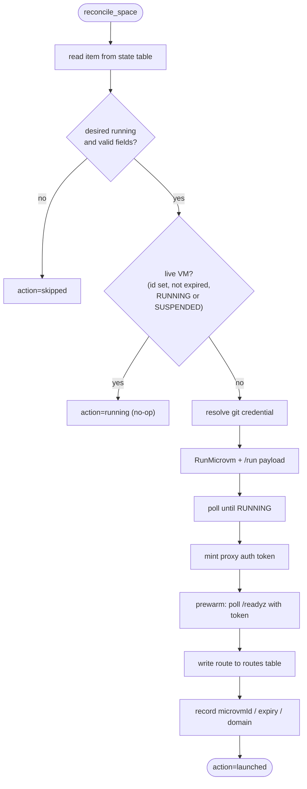
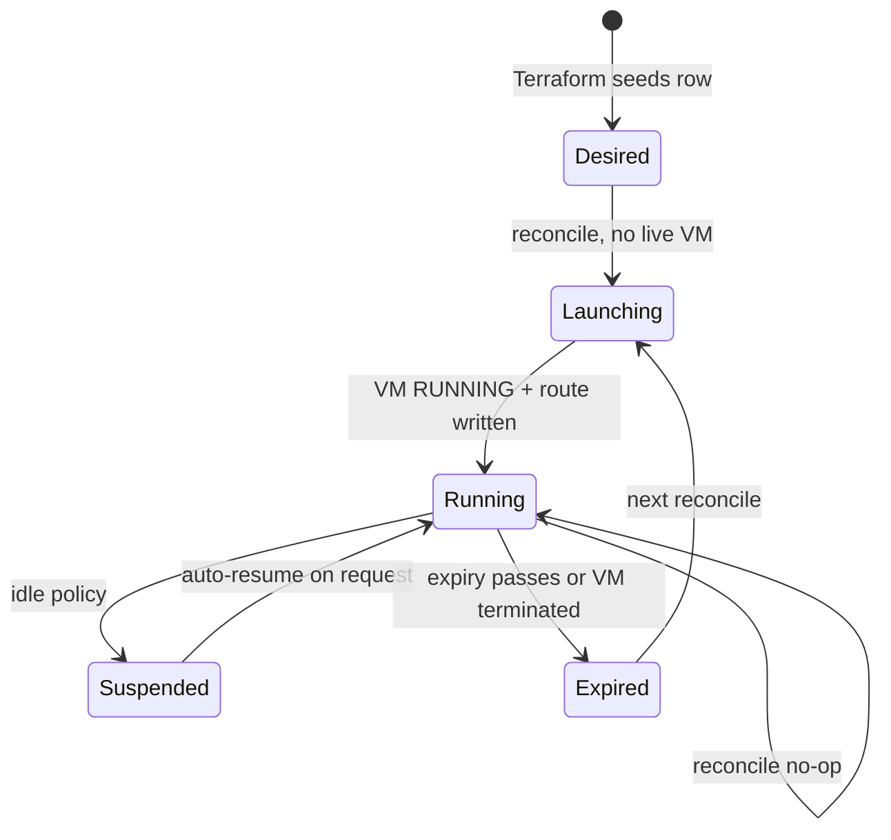

# RTFM - Control Plane

Part of [RTFM](./index.md).

The control plane is two Lambdas driven by EventBridge. Both read and write DynamoDB and call the `lambda-microvms` API. Each Lambda gets `ENV=<env_name>` injected and keys all access by it.

## LifecycleManager

Moves a space from "desired" to "live and routable". Source: `service/control-plane/lifecycle_manager`.

### Entry points

- **Scheduled** (EventBridge, no `space` in the event) — scans the state table and reconciles every `desiredState=running` space.
- **Manual** (`{"space":"platform"}`) — reconciles one space.

### reconcile_space



### The `/run` payload (under 4096 bytes)

| Field | Notes |
|---|---|
| `gitRepoUrl`, `gitBranch` | from the space config |
| `basePath` | `/<space>` |
| `gitToken`, `gitTokenHost`, `gitAuthScheme` | token path (see [Authentication](./authentication.md)); mutually exclusive with SSH |
| `gitSshKey`, `gitKnownHosts` | SSH fallback; read-only deploy key, never logged |
| `externalUrl`, `readOnly` | optional |
| `efsFileSystemDns`, `efsRootPath`, `efsAccessPointId` | added when EFS is wired on the state row |

The state row also carries the VPC egress network connector ARN, which is passed on `RunMicrovm` so the VM can reach EFS.

### Safety properties

- **Idempotent** — a live VM makes reconcile a no-op.
- **`clientToken`** on `RunMicrovm` is `<space>-<now>`, preventing duplicate launches.
- **Validation** — space name (`^[A-Za-z0-9._~-]{1,200}$`), image ARN and VM endpoint are regex-validated before use.
- **Prewarm** — the route is registered only after `/readyz` passes, so no viewer is routed to a booting VM.

### Per-space state machine



## Scheduling and VM lifetime

| EventBridge rule | Default | Target | Purpose |
|---|---|---|---|
| lifecycle reconcile | `rate(15 minutes)` | LifecycleManager | relaunch any desired-running space with no live VM |
| token rotation | `rate(10 minutes)` | TokenRotation | refresh proxy tokens before they expire |

Both schedules are Terraform variables and can be tuned without code changes.

Idle policy set on `RunMicrovm`:

```json
{
  "autoResumeEnabled": true,
  "maxIdleDurationSeconds": 900,
  "suspendedDurationSeconds": 28800
}
```

The VM suspends after idle, resumes automatically on the next request, and is torn down after the suspended duration. `microvmExpiresAt` is launch time plus `maximumDurationInSeconds` (default 3600 s); after expiry the next reconcile relaunches the space.

## TokenRotation

Proxy auth tokens are short-lived. Every forwarded request needs a valid `X-aws-proxy-auth` for the target VM, and the proxy reads it from the routes table. TokenRotation runs more often than tokens expire, so a route's token is always refreshed in time.

For each registered route it:

1. calls `get-microvm` and skips VMs that are not `RUNNING` or `SUSPENDED`;
2. calls `create-microvm-auth-token` for a fresh token on port 9000;
3. validates it (length 1–8192, printable ASCII) and `put_item`s `{space, endpoint, token}` into the routes table.

The summary reports `rotated / skipped / failed / unmatchedRoutes`. A non-zero `unmatchedRoutes` means a route row exists with no live VM (a stale route) and is treated as an error. `skipped` means a terminated VM and is harmless.

TokenRotation's IAM role needs write access to the data-layer routes table.

## Manual operations

Force a space to relaunch now (replace names for your env and data workspace):

```bash
aws dynamodb update-item --table-name rtfm-qa-data-state \
  --key '{"space":{"S":"qa#platform"}}' \
  --update-expression "SET microvmExpiresAt = :z" \
  --expression-attribute-values '{":z":{"N":"0"}}' \
  --profile rtfm-non-prod

aws lambda invoke --function-name rtfm-qa-lifecycle-manager \
  --payload '{"space":"platform"}' --cli-binary-format raw-in-base64-out \
  --profile rtfm-non-prod /tmp/out.json
```
