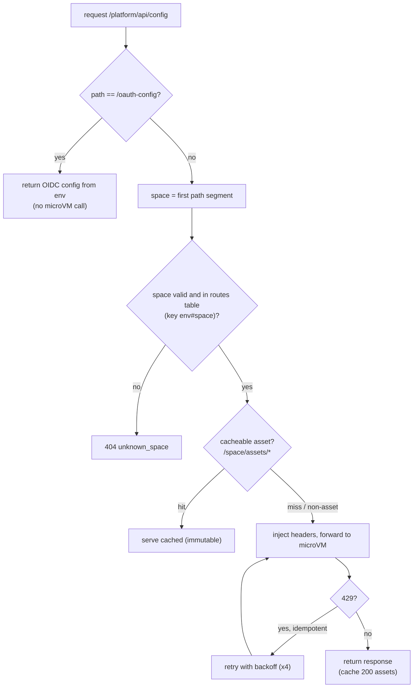

# RTFM - Request Routing

Part of [RTFM](./index.md).

## Front door

RTFM is fronted by a **PRIVATE API Gateway REST API** (`terraform/app/apigw.tf`) with a greedy `ANY /{proxy+}` integration to the proxy Lambda. It is reached through the shared execute-api **VPC endpoint**. The platform `switch-traffic` module creates the private custom domain `<env>.<domain>`, the private-zone Route53 record pointing at the VPC endpoint, a RAM share to the net account, and the VPC endpoint access association.

The proxy handler accepts both the v1 REST and v2 HTTP API event shapes.

### Private-API admission (before the proxy)

API Gateway admits a request at the endpoint layer before the proxy Lambda runs. Admission requires the request's VPC endpoint to have a valid `aws_api_gateway_domain_name_access_association` to the **live** private custom domain. If the association is missing or bound to a stale or deleted domain id, API Gateway returns `403 ForbiddenException` **without** `x-amzn-remapped-*` / `x-amzn-trace-id` headers. A request that reached the Lambda carries those headers.

## Proxy Lambda request path

## Routing key and base path

Every space is served under its name as a path prefix, for example `/platform/...`. The first path segment is both the routing key (the routes-table item for `<env>#<space>`) and the app's `basePath`, so client `/api/*` URLs are prefixed correctly.

## Headers the proxy injects

| Header | Value | Purpose |
|---|---|---|
| `X-aws-proxy-auth` | token from the routes table | microVM proxy authentication |
| `X-aws-proxy-port` | `9000` | microVM proxy target port |
| `Origin` | `http://localhost` | satisfies the app's same-origin CSRF guard (search, link previews, MCP) |
| `X-OK-Forwarded-Host` | the public host | app ingress admission (external-exposure consent) |
| `X-OK-Forwarded-Proto` | `https` | app builds `https://` URLs |

Client-supplied `Origin`, `Host` and `x-ok-forwarded-*` are stripped before forwarding, so only the proxy can set them.

## Asset handling

Immutable, content-hashed assets under `/<space>/assets/*` are cached in the proxy Lambda's `/tmp` and served without a microVM round trip. This removes the first-paint asset storm that otherwise triggers 429s. Non-asset and `/api/*` calls always go upstream, with the 429 retry.

## Reading failures

| Status | Meaning |
|---|---|
| 401 | JWT authorizer rejected the request (missing or invalid Cognito token on `/api/*`) |
| 403, no `x-amzn-remapped-*` headers | Rejected by API Gateway private-API admission — VPC endpoint association problem |
| 403, with trace headers | microVM ingress/CSRF guard (missing forwarded-host or loopback `Origin`) |
| 404 `unknown_space` | First path segment is not a space in the routes table for this env |
| 429 | microVM shed load under concurrency; the proxy retries idempotent requests |
| 502 / cold errors | The VM was routed before it was ready; LifecycleManager prewarms before registering routes (see [Control Plane](./control-plane.md)) |
| 200 | Routed to a live VM that served |
