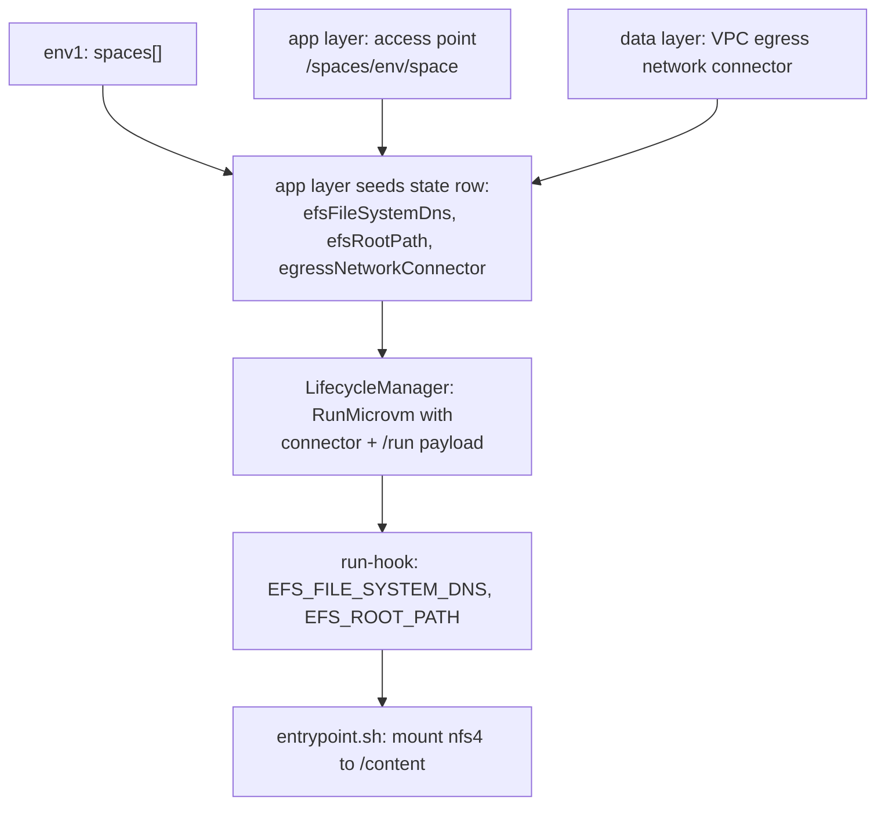

# RTFM - Spaces and Storage

Part of [RTFM](./index.md).

## Spaces are configured in env1

The per-workspace space list lives in env1 `app-env.json` under `<env>.spaces`, in the config bucket `s3://toluna-platform-tf-config-data/rtfm/{app,data,shared}-env.json`. Writes to that bucket require the `platform-net` profile (the bucket owner); other profiles are read-only.

Each env block carries:

| Key | Meaning |
|---|---|
| `env_type` | `non-prod` or `prod` |
| `data_workspace` | the data workspace this env uses (for example `dev-data`) |
| `space_image_arn` | the `rtfm` microVM image ARN for the target account |
| `spaces[]` | `{ name, repo_url, repo_branch }` per space, with optional duration/flag overrides |

The app layer reads `module.config.globals.env_vars.spaces` and, per entry, creates the EFS access point and the DynamoDB seed row. Adding, removing or re-pointing a space is an **env1 config change** picked up on the next deploy or reconcile — no code change.

Current non-prod envs: `qa`, `stg`, `dev`, `idan` (`idan` shares `dev-data`). The `platform` space clones `kb-platform.git` from the `tolunaengineering` Bitbucket workspace.

## The `env` dimension

Several app envs can share one data workspace, so every durable record is tagged with the app env (`env_name`).

| Store | Isolation mechanism |
|---|---|
| DynamoDB | key `"<env>#<space>"` plus `env` / `spaceName` attributes; scans filter on `env` |
| EFS | per-space access point rooted at `/spaces/<env>/<space>` |
| Lambdas | `ENV=<env_name>` injected; handlers key and filter every access by it |

For example `qa`, `dev` and `idan` can each run a `platform` space against the same `dev-data` tables and filesystem without collision.

## EFS persistence

Each space mounts its own EFS path at `/content`, so content survives microVM restarts. The filesystem lives in the **data** layer and per-space access points in the **app** layer, so a blue/green teardown never deletes content.



### Mount sequence in `entrypoint.sh`

1. TCP pre-check on `<efs-dns>:2049` (5 s). If unreachable, log and fall back to ephemeral `/content`.
2. Briefly mount the filesystem root and `mkdir -p /spaces/<env>/<space>` owned `1000:1000`, then unmount.
3. Mount `fs-dns:/spaces/<env>/<space>` at `/content` with **native nfs4**.
4. `chown -R 1000:1000 /content` and set git `safe.directory`.
5. Clone or fast-forward the repo into `/content`, then start the app.

### Four requirements for a working mount

1. **Allow mounts in the image.** The Firecracker sandbox strips mount capability by default. Build the image with `--additional-os-capabilities '["ALL"]'`.
2. **Give the VM a network path into the VPC.** Create an `AWS::Lambda::NetworkConnector` (VPC egress) through the `awscc` provider (`terraform/data/rtfm_network_connector.tf`) and pass it as the **sole** egress connector on `run-microvm`; the API rejects two default-route connectors. The VPC's NAT still provides internet for git. IAM must allow `lambda:PassNetworkConnector` on the account-owned connector ARN.
3. **Use native nfs4.** `-o accesspoint=<id>` is an `amazon-efs-utils` option, not native nfs4. Mount the access point's path directly.
4. **Make git trust the EFS tree.** EFS preserves ownership, which makes git fail with "dubious ownership" and keeps `/readyz` at 503. Set `git config --system --add safe.directory /content` (and `'*'`).

### Sizing

The image is built with `minimumMemoryInMiB=4096` (about 2 vCPU). vCPU scales with memory; there is no separate vCPU setting at image or run level.

### Verifying the mount

```bash
# inside the microVM (SHELL_INGRESS)
mount | grep /content        # fs-...:/spaces/<env>/<space> on /content type nfs4
df -h /content

# from AWS
aws cloudwatch get-metric-statistics --namespace AWS/EFS --metric-name ClientConnections \
  --dimensions Name=FileSystemId,Value=<fs-id> --period 60 --statistics Maximum \
  --start-time <t-10m> --end-time <now> --region us-east-1 --profile rtfm-non-prod
```

`ClientConnections >= 1` and `DataWriteIOBytes > 0` mean the mount is in use. Do not use `SizeInBytes` as a signal; it lags by hours.
